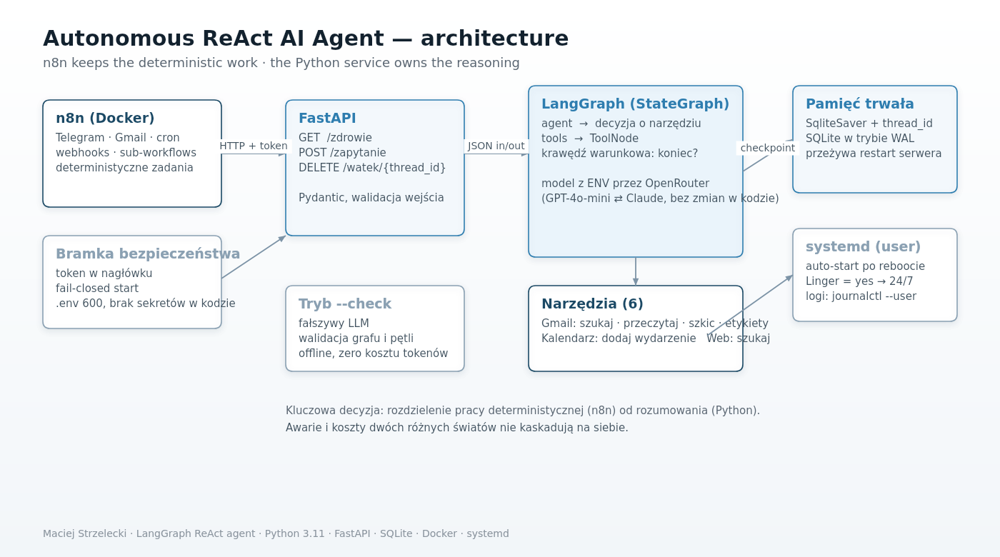

# LangGraph ReAct Agent — reasoning service for n8n

A FastAPI microservice that exposes a [LangGraph](https://langchain-ai.github.io/langgraph/)
ReAct agent to n8n over HTTP.

**The idea:** n8n is excellent at the deterministic part of automation — triggers, schedules,
API calls, notifications. It is the wrong tool for tasks that need judgement. This service is
what n8n calls when a task needs a reasoning loop: the model picks a tool, observes the result
and iterates until it can answer.



---

## Why the split architecture

Wrapping an LLM into the same tool that runs your deterministic jobs couples two very different
failure modes. Keeping the reasoning service separate means it can be tested, restarted and
replaced on its own — and that a model outage degrades one capability instead of the whole
automation stack.

## What is implemented

| Component | State |
|---|---|
| ReAct loop — `StateGraph` with an agent node, a `ToolNode` and a conditional edge | ✅ working |
| Persistent memory — `SqliteSaver` keyed by `thread_id`, SQLite in WAL mode | ✅ working |
| REST API — health, query and thread-deletion endpoints (FastAPI + Pydantic) | ✅ working |
| Token authentication with a fail-closed start-up | ✅ working |
| Offline validation — `--check` mode with a fake LLM, no API key needed | ✅ working |
| systemd service for automatic start after reboot | ✅ working |
| Tool layer | ✅ 7 tools — 6 backed by n8n webhooks (Gmail, calendar, web search) + 1 credential-free example |

## Quick start

```bash
# 1. environment
python3 -m venv .venv
./.venv/bin/pip install -r requirements.txt

# 2. generate the API token (written to .env with 600 permissions)
./run-serwer.sh --nowy-token

# 3. add your model key to .env
#    OPENROUTER_API_KEY=sk-or-v1-...

# 4. run the service
./run-serwer.sh
```

The service listens on `127.0.0.1:8100` by default. To let the n8n container reach it, bind to
the Docker host address:

```bash
LANGGRAPH_HOST=172.18.0.1 ./run-serwer.sh
```

## Tools

| Tool | Arguments | Backed by |
|---|---|---|
| `gmail_szukaj` | `q` (Gmail query syntax) | n8n webhook |
| `gmail_przeczytaj` | `id` (from a previous search) | n8n webhook |
| `gmail_szkic` | `akcja`: `utworz` \| `usun` | n8n webhook |
| `gmail_etykiety` | `akcja`: `dodaj` \| `oznacz` | n8n webhook |
| `kalendarz_dodaj` | `od`, `tytul`, optional time and place | n8n webhook |
| `web_szukaj` | `zapytanie` | n8n webhook |
| `pobierz_pogode` | `miasto` | open-meteo (no credentials) |

The tool list is the agent's capability boundary: the model cannot do anything that is not on
this list. That is why the first version's `n8n_activate_workflow` and `n8n_deactivate_workflow`
tools were removed — an agent that can disable its own automations is a liability, not a feature.
The production set was pruned from 14 tools to 6 by removing workflow control and merging
overlapping Gmail actions behind routers.

`pobierz_pogode` is kept deliberately as a credential-free example, so the project can be
cloned, run and tested without any API keys or OAuth setup.

## API

| Method | Path | Token | Purpose |
|---|---|---|---|
| `GET` | `/zdrowie` | no | liveness check |
| `POST` | `/zapytanie` | **yes** | the agent call |
| `DELETE` | `/watek/{thread_id}` | **yes** | clears a conversation's memory |

Authentication uses the `X-API-Token` header. **The service refuses to start without a
configured token** — it fails closed rather than running open by accident.

```bash
curl -X POST http://127.0.0.1:8100/zapytanie \
  -H "X-API-Token: $LANGGRAPH_TOKEN" \
  -H 'Content-Type: application/json' \
  -d '{"thread_id": "user-123", "message": "What is the weather in Berlin?"}'
```

## Testing without spending tokens

```bash
python agent_react_langgraph.py --check
```

Runs the graph against a fake LLM: validates the graph structure and the entire ReAct loop
offline, with no API key and no token cost. This is the mode to run in CI, and it is what makes
an otherwise non-deterministic component testable.

## Configuration

Everything is environment-driven — no code changes to switch models or hosts:

| Variable | Default | Meaning |
|---|---|---|
| `OPENROUTER_API_KEY` | — | required to call the model |
| `OPENROUTER_MODEL` | `openai/gpt-4o-mini` | any OpenRouter model, e.g. `anthropic/claude-3.5-sonnet` |
| `LANGGRAPH_TOKEN` | — | API token (generated by `--nowy-token`) |
| `LANGGRAPH_HOST` | `127.0.0.1` | bind address |
| `LANGGRAPH_PORT` | `8100` | bind port |

## Running as a service

```bash
systemctl --user status  langgraph-serwer
systemctl --user restart langgraph-serwer
journalctl --user -u langgraph-serwer -f
```

A user-level unit with `Linger=yes`, so the service comes back by itself after a VPS reboot.

## Status and limitations

This is a personal project running as a single instance. Being explicit about the edges:

- **The tools need n8n.** Gmail, calendar and web search are not integrated here directly —
  each tool calls a webhook in my n8n instance, which owns the OAuth credentials. Running the
  agent on its own gives you the reasoning loop and the weather tool; the domain tools need the
  companion workflows.
- **No label-listing action yet.** `gmail_etykiety` supports `dodaj` and `oznacz`; listing
  available labels is still done inside the n8n workflow.
- **SQLite, not Postgres.** Fine for one instance. The checkpointer is one component, so the
  migration is swapping the saver rather than rewriting the agent.
- **No evaluation set yet.** Prompt and model changes are currently verified by hand. An eval
  suite is the thing I would build before adding features.
- **No per-user rate limiting.** A single shared token today.

## License

MIT
